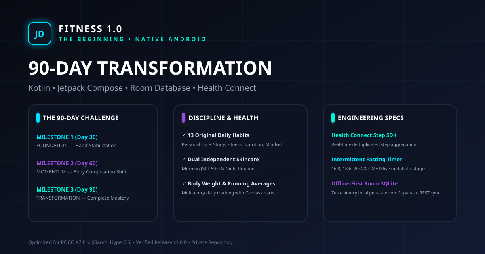
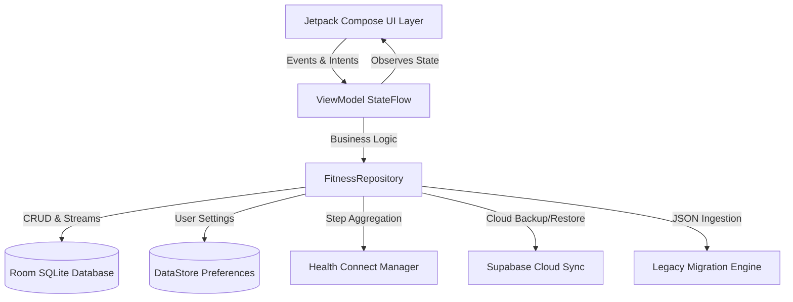

# FITNESS 1.0 — THE BEGINNING
### Native Android Fitness, Health-Habit, Productivity & Self-Discipline Operating System

[-3DDC84?style=for-the-badge&logo=android&logoColor=white)](https://developer.android.com)
[](https://kotlinlang.org)
[](https://developer.android.com/jetpack/compose)
[](https://developer.android.com/training/data-storage/room)
[](https://developer.android.com/health-and-fitness/guides/health-connect)
[](LICENSE)

Brand Initials: **JD**  
Optimized Target Device: **POCO X7 Pro (Xiaomi HyperOS / Android 14+)**

<p align="center">
  
</p>

---

## ⚡ Overview

**FITNESS 1.0** is an offline-first, production-grade native Android personal command center engineered with **Kotlin**, **Jetpack Compose**, **Material 3**, and **Room Database**.

It is designed for ruthless self-discipline, body composition tracking, and daily productivity, centered around an immutable **90-Day Challenge** (3 November 2026 to 31 January 2027) with progressive milestones:
- **Day 30 — FOUNDATION**
- **Day 60 — MOMENTUM**
- **Day 90 — TRANSFORMATION**

---

## 💎 Design & Visual Identity

- **Theme**: Dark Holographic Command Center (`#070B14`, `#0D1322`, `#121B33`)
- **Accents**: Neon Electric Blue (`#00E5FF`), Neon Purple (`#9D4EDD`), Cyan (`#00F5D4`), Magenta (`#FF007F`), Amber (`#FFB703`)
- **Components**: Glassmorphism cards with glowing neon borders, interactive Canvas charts, and custom JD branding vectors.

---

## 🏛️ System Architecture



---

## 📱 Core Modules & Capabilities

### 1. 90-Day Challenge Engine
- Dynamic countdown: Current Day, Days Completed, Days Remaining, Overall Progress %.
- Milestones unlocking automatically at Day 30, Day 60, and Day 90.
- Configurable dates in Settings without destroying existing records.

### 2. Daily Habit Checklist (The 13 Original Habits)
1. **Brush teeth daily** *(Personal Care)*
2. **Bath daily** *(Personal Care)*
3. **Study at home — 1 hour** *(Study)*
4. **Morning skincare** *(Personal Care - Independent Routine)*
5. **Night skincare** *(Personal Care - Independent Routine)*
6. **Avoid junk and processed food** *(Nutrition)*
7. **Home workout — once** *(Fitness)*
8. **No added sugar** *(Nutrition)*
9. **10,000 steps** *(Fitness - Health Connect Sync)*
10. **No pornography** *(Mindset)*
11. **No smoking** *(Mindset)*
12. **No alcohol** *(Mindset)*
13. **Personal discipline goal** *(Mindset - Private & customizable)*

*Features: Full CRUD for custom habits, category grouping, calendar date preservation, habit-specific streaks, and daily completion scores.*

### 3. Body Weight Tracker
- Kilogram tracking with multiple daily readings and exact timestamps.
- Never overwrites earlier readings.
- Interactive Canvas line chart with data points and gradient fill.
- Weekly, monthly, and all-time running averages.

### 4. Skincare Tracker
- Two independent routines: **Morning** (Cleanser, Moisturizer, Sunscreen SPF 50+) and **Night** (Cleanser, Moisturizer, Treatment/Serum).
- Never auto-completes: requires deliberate daily check-in.
- Product customization and step addition.

### 5. Intermittent Fasting & OMAD Tracker
- Live elapsed-time counter with background accuracy.
- Configurable targets: 16:8, 18:6, 20:4, and OMAD (23h).
- Meal logging and eating-window tracking.
- Underage (< 18) guard notice and safe zero-penalty cancellation.

### 6. Automatic Step Tracking (Health Connect & POCO X7 Pro)
- Official Android Health Connect SDK integration (`androidx.health.connect:connect-client:1.1.0-alpha07`).
- Reads sensor step records from POCO X7 Pro / Google Play Services.
- Aggregation with overlap deduplication.
- Progress toward 10,000 steps (automatically completes Habit #9).
- Manual step fallback entry if permission is disabled.

### 7. Calendar & Historical Editing
- Full challenge calendar with daily completion score indicators.
- Select any past date to view and retrospectively update checklist items.
- Perfect day highlights.

### 8. Analytics & Statistics
- Calculated strictly from stored Room database entries (zero mock/invented data).
- Current streak, longest streak, perfect days count, total check-ins.
- Interactive weight trend and 7-day step performance charts.
- Weekly consistency heatmap.

### 9. Scheduled Reminders & Notifications
- Local alarms for Morning Skincare, Night Skincare, Study, Workout, Weigh-in, Step Check, and Daily Review.
- Android 13+ permission compliant (`POST_NOTIFICATIONS`).

### 10. Supabase Cloud Sync & Legacy Migration
- Integrated with Supabase project `Fitness-season-1`, table `season10_progress`.
- Secure client configuration using public Anon key (no service-role secrets exposed).
- **Legacy Migration System**: Imports old `season10-data-v1` JSON backup from phone. Detects the old 12-habit format, preserves legacy skincare without falsely splitting them, and presents a migration preview summary before import.

---

## 🛠️ Project Structure

```
C:\FITNESS
├── app/
│   ├── build.gradle.kts
│   ├── proguard-rules.pro
│   └── src/
│       ├── main/
│       │   ├── AndroidManifest.xml
│       │   ├── java/com/jd/fitness/
│       │   │   ├── FitnessApp.kt
│       │   │   ├── MainActivity.kt
│       │   │   ├── data/
│       │   │   │   ├── local/ (FitnessDatabase, Converters, entities, DAOs)
│       │   │   │   ├── preferences/ (DataStore repository)
│       │   │   │   ├── health/ (HealthConnectManager)
│       │   │   │   ├── sync/ (SupabaseManager, SyncModels)
│       │   │   │   ├── backup/ (BackupManager, LegacyMigrationManager, models)
│       │   │   │   └── repository/ (FitnessRepository)
│       │   │   ├── notification/ (NotificationReceiver, NotificationScheduler)
│       │   │   └── ui/
│       │   │       ├── theme/ (Color, Theme, Type)
│       │   │       ├── components/ (HolographicComponents, HolographicCharts)
│       │   │       ├── navigation/ (Screen, AppNavigation)
│       │   │       └── screens/ (dashboard, challenge, habits, weight, skincare, fasting, steps, calendar, analytics, settings)
│       │   └── res/ (drawable vectors, mipmaps, values, xml health permissions)
│       └── test/ (unit tests for challenge, streaks, and migration)
├── build.gradle.kts
├── settings.gradle.kts
├── gradle.properties
├── gradlew & gradlew.bat
├── build-debug-apk.bat
├── .env.example
├── .gitignore
├── CHANGELOG.md
├── CONTRIBUTING.md
├── LICENSE
├── SECURITY.md
├── SUPABASE_SETUP.md
├── HEALTH_CONNECT_SETUP.md
└── RELEASE_SIGNING_GUIDE.md
```

---

## 🚀 Building & Testing

### 1. Build Debug APK
Run the Gradle wrapper or helper script:
```powershell
.\gradlew.bat assembleDebug
```
Or execute:
```cmd
build-debug-apk.bat
```
The installable APK will be generated at `app/build/outputs/apk/debug/app-debug.apk` (and `FITNESS-1.0-debug.apk`).

### 2. Run Unit Tests
```powershell
.\gradlew.bat testDebugUnitTest
```

### 3. Signed Production Release APK
Refer to [`RELEASE_SIGNING_GUIDE.md`](RELEASE_SIGNING_GUIDE.md) for keystore creation, ProGuard minification, and signing steps.

---

## 📖 Supporting Documentation

- [`HEALTH_CONNECT_SETUP.md`](HEALTH_CONNECT_SETUP.md): Setup instructions for POCO X7 Pro and Xiaomi HyperOS.
- [`SUPABASE_SETUP.md`](SUPABASE_SETUP.md): Configuration for `Fitness-season-1` cloud sync and RLS policies.
- [`RELEASE_SIGNING_GUIDE.md`](RELEASE_SIGNING_GUIDE.md): Keystore generation and release build commands.
- [`CONTRIBUTING.md`](CONTRIBUTING.md): PR and contribution workflow.
- [`SECURITY.md`](SECURITY.md): Security architecture and vulnerability disclosure.

---

## 📄 License

This project is licensed under the MIT License - see the [`LICENSE`](LICENSE) file for details.
