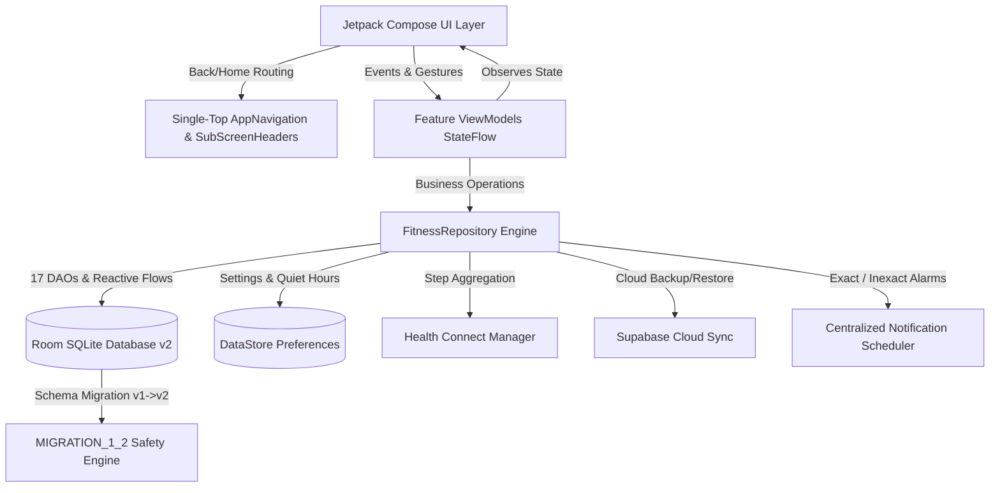

# FITNESS 1.2 — THE INTELLIGENT PERSONAL COMPANION (JD EDITION)
### Native Android Fitness, Health-Habit, Productivity, Recovery & Intelligent Personal Companion

[-3DDC84?style=for-the-badge&logo=android&logoColor=white)](https://developer.android.com)
[](https://kotlinlang.org)
[](https://developer.android.com/jetpack/compose)
[-00599C?style=for-the-badge&logo=sqlite&logoColor=white)](https://developer.android.com/training/data-storage/room)
[](https://developer.android.com/health-and-fitness/guides/health-connect)
[](LICENSE)

Brand Initials: **JD**  
Optimized Target Device: **POCO X7 Pro (Xiaomi HyperOS / Android 14+)**

---

## ⚡ Overview

**FITNESS 1.2** upgrades the foundational personal command center into an **Intelligent Personal Companion**. It combines premium fitness tracking, daily habit discipline, smart time-slot planning, private self-reflection, evidence-backed recovery monitoring, milestone gamification, and an offline-first adaptive AI coach.

Built with an **offline-first, zero-fabrication architecture**, every statistic, streak, and coach recommendation is calculated strictly from genuine database records.

---

## 💎 Design & Visual Identity

- **Theme**: Dark Holographic Command Center (`#070B14`, `#0D1322`, `#121B33`)
- **Accents**: Electric Blue (`#00E5FF`), Neon Purple (`#7928CA`), Cyan (`#00F5D4`), Emerald Green (`#10B981`), Amber (`#FFB703`), Coral (`#FF4D4D`)
- **Components**: Glassmorphism cards with glowing neon borders, interactive Canvas charts, dedicated SubScreen back/home headers, and custom JD branding vectors.

---

## 🏛️ System Architecture



---

## 🚀 Key Modules & Capabilities (FITNESS 1.2)

### 1. Fasting Tracker 2.0
- **Independent Custom Schedules**: Freely choose custom starting and ending dates and times.
- **Schedule Presets & Library**: Quick presets for 12:12, 14:10, 16:8, 18:6, 20:4, and OMAD (23h) plus custom schedule creation and editing.
- **Isolated Live Timer Widget**: Real-time `HH:MM:SS` ticking counter without triggering full-screen recompositions.
- **Educational Fasting Stages**: Approximate science-based timeline (Early Post-Meal, Post-Absorptive, Nutrient Transition, Stored Energy Utilization, Metabolic Adaptation).
- **History & Session Editing**: Edit, stop, or delete past fasting records with confirmation dialogs.
- **Safety**: Underage safety notices and zero-penalty cancellation.

### 2. Recovery Centre
- **Overtraining Prevention**: Detects 5+ consecutive workout days and proactively recommends rest.
- **Rest Day Logging**: Dedicated toggle to record active rest days.
- **Sleep & Energy Sliders**: Track sleep duration (hours) and perceived energy (1-5 chips).
- **Evidence-Based Guidance**: Non-medical recovery suggestions for stretching, hydration, and sleep hygiene.

### 3. My Daily Plan (Smart Scheduler)
- **Time-Slot Agenda**: Organize tasks across 9 categories (Morning Routine, College, Study, Fitness, Skincare, Meals, Tasks, Evening, Sleep).
- **Smart Suggestions**: Automatically suggest structured schedules based on active habits and preferences.
- **Task Management**: Check off completed tasks, edit times, delete entries, and view completed history.

### 4. Discipline Milestones
- **Multi-Tier Gamification**: Real achievements across Habit Consistency, Fitness, and Productivity.
- **Genuine Records Only**: Progress bars reflect genuine database records (e.g. 7-day, 14-day, 30-day, 60-day, 90-day streaks; 10k steps; study milestones).
- **Unlock Celebrations**: Unlocked achievements show celebratory neon badges and preserve unlock timestamps permanently.

### 5. Weekly Intelligence Reports
- **Automated Sunday Intelligence**: Full audit of compliance percentage, best-performing habit, habit needing improvement, average steps, and workouts.
- **3 Practical Suggestions**: Actionable coaching advice generated from actual metric thresholds.
- **PDF Export & Sharing**: Built-in Android `PdfDocument` generation and Android intent sharing.

### 6. My Private Journal
- **Private by Default**: Local-only Room database storage; excluded from notifications and cloud sync unless explicitly requested.
- **Structured Prompts**: "What went well?", "What distracted me?", "What can I improve tomorrow?".
- **Mood Tracking**: Interactive mood chips (Great, Good, Neutral, Challenging, Exhausted).
- **Search & Calendar**: Instant live search by keyword and past entry date browsing.

### 7. Motivation Hub
- **Daily Principle & Challenge**: Fresh daily discipline principle and micro-challenge.
- **8 Dedicated Categories**: Discipline, Focus, Resilience, Fitness, Study, Consistency, Morning, Recovery.
- **Adaptive Encouragement**: Context-aware messages driven by today's habit completion status.
- **Custom Principles**: Add, favorite, and manage custom motivational principles.

### 8. FITNESS AI Coach
- **4 Adaptive Personality States**:
  - `HIGH PERFORMANCE`: High habit compliance (>= 80%) and regular workouts.
  - `STRUGGLING`: Low completion (< 40%); simplifies targets and removes guilt.
  - `INCONSISTENT`: Fluctuating habits; identifies skipped patterns and recommends time blocking.
  - `RECOVERY NEEDED`: Rest days, overtraining streak, or low energy levels.
- **Evidence-Backed Insights**: Every recommendation cites actual stored metrics (e.g., "Supported by: 85% compliance, 4 workouts").
- **Local Offline Engine**: Runs 100% offline via local rule-based intelligence; transparently labeled.

### 9. Dashboard Integration & Holographic JD Theme
- **Comprehensive Command Center**: Fasting timer, Recovery readiness, Daily agenda, AI coach guidance, Today's checklist, and Quick Action buttons.
- **Lifecycle Auto-Refresh**: Automatically updates all widgets when resuming the app (`refreshAll()`).
- **Clean Bottom Navigation**: Single-top navigation across `[Dashboard, Habits, Planner, Coach, Settings]` preventing backstack clutter.

### 10. Notification Intelligence
- **Quiet Hours Enforcement**: Configurable quiet hours (e.g. 22:00 to 07:00) during which sound reminders are silenced.
- **Exact & Inexact Alarms**: Safe `AlarmManager.canScheduleExactAlarms()` handling on Android 12+ (API 31+) with inexact fallback to prevent crashes.

---

## 🛠️ Project Structure

```
d:\FITNESS
├── app/
│   ├── build.gradle.kts (versionCode = 2, versionName = "1.2.0")
│   └── src/
│       ├── main/
│       │   ├── AndroidManifest.xml
│       │   └── java/com/jd/fitness/
│       │       ├── FitnessApp.kt
│       │       ├── MainActivity.kt
│       │       ├── data/
│       │       │   ├── local/
│       │       │   │   ├── FitnessDatabase.kt (Room v2, MIGRATION_1_2)
│       │       │   │   ├── dao/ (17 DAOs)
│       │       │   │   └── entity/ (17 Entities)
│       │       │   ├── backup/ (BackupManager, BackupModels v2)
│       │       │   ├── sync/ (SupabaseManager, SyncModels v2)
│       │       │   ├── preferences/ (UserPreferencesRepository)
│       │       │   └── repository/ (FitnessRepository)
│       │       ├── notification/ (NotificationScheduler, NotificationReceiver)
│       │       └── ui/
│       │           ├── navigation/ (Screen.kt, AppNavigation.kt)
│       │           ├── components/ (HolographicComponents, HolographicCharts)
│       │           └── screens/
│       │               ├── dashboard/
│       │               ├── fasting/ (Fasting 2.0 & isolated live timer)
│       │               ├── recovery/ (Recovery Centre)
│       │               ├── planner/ (Daily Plan)
│       │               ├── milestones/ (Discipline Milestones)
│       │               ├── reports/ (Weekly Intelligence & PDF Export)
│       │               ├── journal/ (Private Journal)
│       │               ├── motivation/ (Motivation Hub)
│       │               ├── coach/ (FITNESS AI Coach)
│       │               ├── habits/
│       │               ├── challenge/
│       │               ├── weight/
│       │               ├── skincare/
│       │               ├── steps/
│       │               ├── calendar/
│       │               ├── analytics/
│       │               └── settings/
│       └── test/ (Unit tests: Streak, Migration, Fasting, Recovery, Milestones, Reports, Coach)
├── FITNESS-1.2-release.apk (Signed production release APK)
├── FITNESS-1.2-debug.apk (Debug APK)
```

---

## 🧪 Testing & Verification

All 31 unit tests pass with **100% success rate**:
```powershell
.\gradlew.bat testDebugUnitTest
```
- `ChallengeCalculationTest`: 90-day progress, milestones, boundaries.
- `FastingCalculationTest`: HH:MM:SS timer formatting, progress percentages, educational stages, overnight fasting.
- `RecoveryCalculationTest`: Rest-day detection, overtraining alert (5+ consecutive days), sleep readiness.
- `MilestonesCalculationTest`: First workout, 7-day streak, 10k steps, progress clamping, anti-regression.
- `WeeklyReportCalculationTest`: Compliance rates, best/worst habit identification, actionable suggestions.
- `CoachAdaptiveEngineTest`: 4 adaptive states (High Performance, Struggling, Inconsistent, Recovery Needed) with record evidence.
- `HabitStreakTest`: Consecutive completions, skipped day resets.
- `LegacyMigrationValidationTest`: V1 to V2 JSON migration integrity.

---

## 📦 Building Installable APKs

### Build Debug APK
```powershell
.\gradlew.bat assembleDebug
```
Output: `FITNESS-1.2-debug.apk`

### Build Signed Release APK
```powershell
.\gradlew.bat assembleRelease
```
Output: `FITNESS-1.2-release.apk`

---

## 📄 License

This project is licensed under the MIT License - see the [`LICENSE`](LICENSE) file for details.
